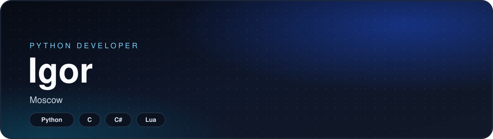

Python first. C, C++, Lua, Rust, and TypeScript when the job needs them.

## About

I am a Python developer in Moscow. Python is home base. C, C++, C#, Lua, Rust, and TypeScript are how I get closer to a runtime, a launcher, or a service.

Right now that means language modules for [NodeMP](https://github.com/Igor20264/NodeMP-C_ABI-Python). Each one is a C ABI host: CPython, MicroPython, LuaJIT, QuickJS, Luau, Squirrel, and Wren. Scripts talk to the server through a global `node`, and long work can leave the game tick and run on a thread pinned to one core.

Around that I build FastAPI and Flask services, Telegram bots, and desktop shells in Tauri and Electron.

## Stack

**Languages**

**Runtimes**

**Backend**

**Apps**

**Tools**

---

## По-русски

Я пишу на Python и живу в Москве. Python — основная работа. На C, C++, C#, Lua, Rust и TypeScript перехожу, когда нужен хост, лаунчер или сервис.

Сейчас это языковые модули NodeMP. Каждый из них — хост на C ABI: CPython, MicroPython, LuaJIT, QuickJS, Luau, Squirrel и Wren. Скрипт видит глобальный `node`, а долгая работа уходит с игрового тика на поток, закреплённый за одним ядром.

Рядом сервисы на FastAPI и Flask, боты Telegram и оболочки на Tauri и Electron.
