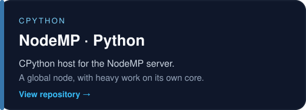
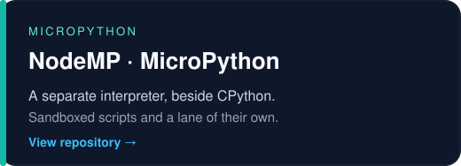
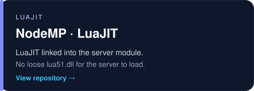
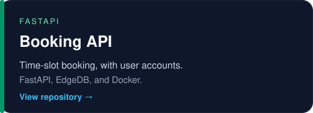

Python first. C, C#, and Lua when the runtime needs a closer look.

## About

I am a Python developer and a student at RTU MIREA in Moscow. Python is home base. C, C#, and Lua are how I get closer to a runtime, a host, or a small tool that should stay out of the way.

Right now that means language modules for [NodeMP](https://github.com/Igor20264/NodeMP-C_ABI-Python). Each one is a C ABI host: CPython, MicroPython, or LuaJIT. Scripts talk to the server through a global `node`, and long work can leave the game tick and run on a thread pinned to one core.

On the backend I built a small booking service: FastAPI, EdgeDB, and Docker, with users and time-slot reservations.

## Stack

**Languages**

**Backend**

## Projects

&nbsp;

 

&nbsp;

 

Also [Starter-Minecraft-Server](https://github.com/Igor20264/Starter-Minecraft-Server) — a small Python starter for a Minecraft server.

## GitHub

&nbsp;

---

## По-русски

Я пишу на Python и учусь в РТУ МИРЭА в Москве. Python — основная работа. На C, C# и Lua перехожу, когда нужно подойти ближе к рантайму, к хосту языка или к небольшой утилите.

Сейчас это языковые модули NodeMP. Каждый из них — хост на C ABI: CPython, MicroPython или LuaJIT. Скрипт видит глобальный `node`, а долгая работа уходит с игрового тика на поток, закреплённый за одним ядром.

Из бэкенда есть небольшой сервис бронирования: FastAPI, EdgeDB и Docker, пользователи и слоты времени.

| Проект | Что это |
| --- | --- |
| [NodeMP · Python](https://github.com/Igor20264/NodeMP-C_ABI-Python) | Хост CPython. Скрипт видит `node`, тяжёлая работа сидит на своём ядре. |
| [NodeMP · MicroPython](https://github.com/Igor20264/NodeMP-C_ABI-micropython) | Отдельный интерпретатор рядом с CPython. Скрипты в песочнице, своя очередь задач. |
| [NodeMP · LuaJIT](https://github.com/Igor20264/NodeMP-C_ABI-luajit) | LuaJIT вшит в модуль сервера. Отдельный `lua51.dll` серверу не нужен. |
| [Booking API](https://github.com/Igor20264/CRUD_test_task) | Бронирование слотов времени. FastAPI, EdgeDB и Docker. |
| [Starter-Minecraft-Server](https://github.com/Igor20264/Starter-Minecraft-Server) | Небольшой запуск сервера Minecraft на Python. |
